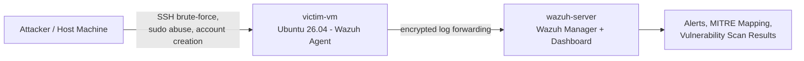
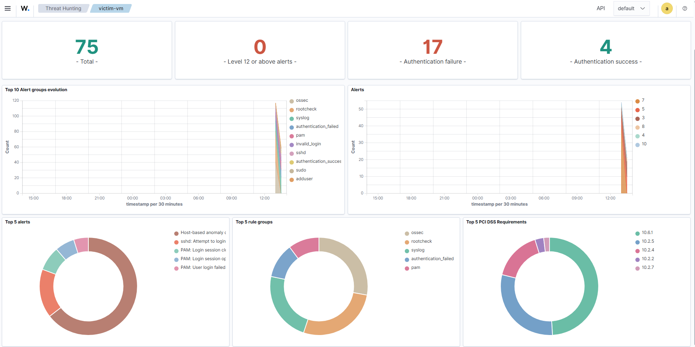
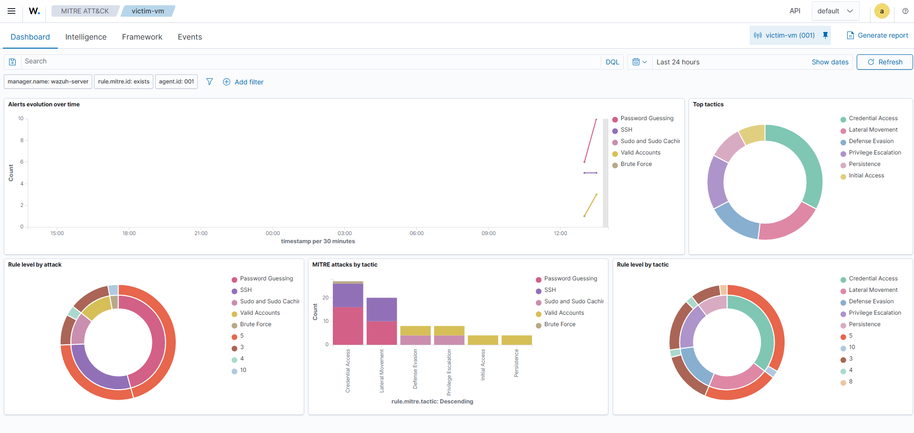
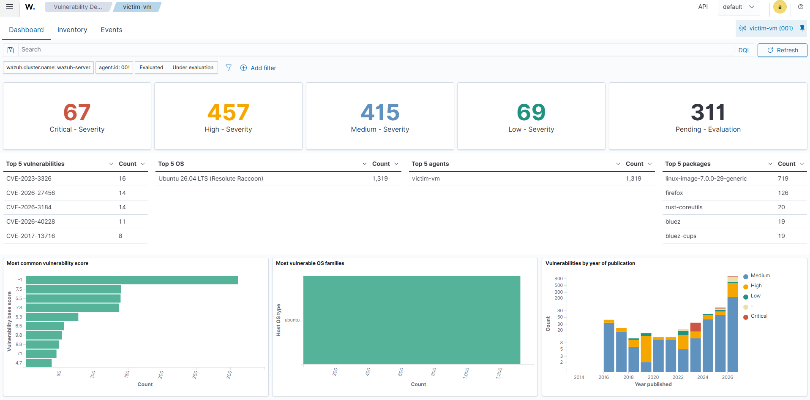

# Wazuh SOC Lab: SIEM Deployment, Detection & Vulnerability Assessment

A self-hosted Wazuh SIEM lab built to demonstrate end-to-end SOC analyst skills. Demonstrated skills include deploying a manager/agent architecture, generating and detecting simulated attacks, mapping detections to MITRE ATT&CK, and performing a passive vulnerability assessment.

## Overview

This project simulates a small enterprise monitoring setup using [Wazuh](https://wazuh.com/), an open-source SIEM/XDR platform. A Wazuh manager was deployed and connected to a monitored Ubuntu endpoint. The Ubuntu endpoint was then attacked with real techniques meant to validate detection coverage and correlated, pattern-based detection instead of just single-event log matching.

**What this demonstrates:**
- SIEM deployment and agent enrollment (manager/agent architecture, networking, TLS)
- Log-based detection engineering and alert triage
- MITRE ATT&CK mapping and technique/tactic analysis
- Incident report writing 
- Vulnerability assessment and remediation prioritization

## Why Wazuh

I chose Wazuh over other SIEM options for a few practical reasons:

- **Open source and self-hostable with no ingestion caps.** My first choice was Splunk; However, Splunk's free tier limits ingestion to 500MB/day and locks most enterprise features behind a license. So building a realistic manager/agent setup meant hitting a paywall quickly. Wazuh has no artificial limits and no paywall, which made a full self-hosted deployment possible at zero cost.
- **More than a log SIEM.** Wazuh has a host of features including host-based intrusion detection, file integrity monitoring, and vulnerability detection alongside log analysis. That is why this single build could produce both the MITRE-mapped detection alerts and the CVE assessment. A log-only alternative would not provide the vulnerability scanning out of the box.

The skills demonstrated in this lab carry over directly to Splunk or Elastic if a role uses those instead. Log ingestion, detection rule logic, alert triage, and MITRE mapping are the same concepts regardless of the platform, and the concepts matter more than the specific product.

## Architecture



## Dashboard Screenshots

**Wazuh Overview: Agent Deployed and Reporting**


**MITRE ATT&CK module: Tactics and Techniques by Agent**


**Vulnerability Detection module: Findings by Severity**


## Techniques Tested

| Technique | MITRE ID | Tactic | Result |
|---|---|---|---|
| SSH password guessing | T1110.001 | Credential Access | Detected: Rule 5710, 5503, 5557 |
| Sustained brute-force (correlated) | T1110 | Credential Access | Detected: Rule 2502, **Level 10** |
| Sudo privilege escalation |  | Privilege Escalation | Detected: Rule 5402, 5403 |
| Unauthorized account creation | T1136 | Persistence | Detected: Rule 5902 |
| Passive vulnerability scan |  |  | 1,319 findings, 67 Critical |

Full detail, raw logs, and analysis are in [`reports/incident-report.md`](reports/incident-report.md).

## Key Findings

- **28 alerts** were generated with a MITRE ATT&CK mapping across 6 tactics.
- Repeated failed logins successfully escalated from individual Level 5 alerts into a single **correlated Level 10 brute-force alert** thus validating Wazuh's frequency-based detection, not just per-event logging.
- A simulated persistence technique, new local user creation, was correctly detected and mapped to **T1136 (Create Account)**.
- Passive vulnerability scan of the endpoint identified **67 critical** and **457 high-severity** CVEs, concentrated in the kernel image and Firefox packages.

## Repo Structure

```
.
├── README.md
├── reports/
│   └── incident-report.md          # Full write-up: timeline, detections, analysis, recommendations
└── evidence/
    ├── pdf/
    │   ├── wazuh-threat-hunting-report.pdf
    │   └── wazuh-mitre-attack-report.pdf
    └── screenshots/
        ├── dashboard-overview.png
        ├── mitre-attack-module.png
        └── vulnerability-detection-module.png
```

## Tools Used

- **Wazuh 4.14.7** (manager + dashboard + agent): Self-hosted via OVA deployment
- **VirtualBox** : Manager and victim endpoint virtualization
- **Ubuntu 26.04 LTS** : Monitored endpoint OS

## Skills Demonstrated

`SIEM deployment` · `log analysis` · `MITRE ATT&CK mapping` · `incident response reporting` · `vulnerability assessment` · `Linux administration` · `network configuration`

---

*This is a self-directed lab project built for learning and portfolio purposes. All attacks were simulated against a personally owned, isolated lab environment.*
